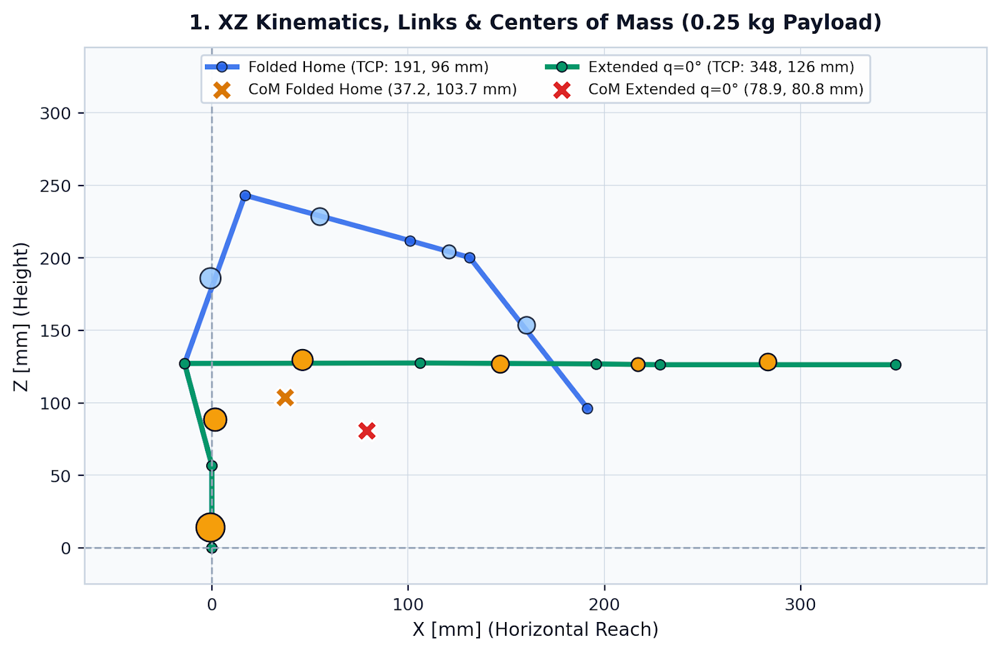

# SAR Robot Controller 1.6

**Mobile search-and-rescue robotics platform**

A Python/PySide6 desktop controller for a differential-drive AGV, a servo-driven arm, the COCO handheld controller, two ESP32-S3 IP cameras, and a COIN-D6 LiDAR. The repository includes firmware, editable CAD, engineering drawings, and PCB fabrication files.

[Software modules](#software-modules) · [Hardware and firmware](#hardware-and-firmware) · [Mechanical design](#mechanical-design) · [Quick start](#quick-start)

## Control and sensing

| Workspace | What it does |
| --- | --- |
| **AGV** | Manual driving, wheel odometry, BNO055 heading hold and precision turns, wheel calibration, and a 50 cm ground-distance calibration. Global controls manage PC/COCO ownership, power, STOP, and E-STOP. |
| **Arm V7** | 3D preview, joint and Cartesian controls, gripper control, and path preview. Forward kinematics (FK) calculates the tool position from joint angles. Inverse kinematics (IK) solves for joint angles to reach an XYZ target. The four-axis model is separate from wrist rotation and gripper commands. |
| **IP Cameras · ArUco** | Independent AGV and arm video feeds with ArUco ID detection. Camera calibration and the physical marker size enable camera-frame pose and distance estimates. The AGV camera uses a saved reference for a supervised approach to ArUco ID 12. Pickup and release sequences are started separately. |
| **LiDAR / SLAM** | Live COIN-D6 scans, raw recording and offline replay, and experimental local 2D mapping. Scan matching can use encoder and IMU motion estimates. The workspace provides range summaries, guidance back to a saved pose, and NPZ/PNG map export. See the [LiDAR and SLAM guide](LIDAR_SLAM.md). |
| **Routines** | Build and save ordered programs with encoder/IMU moves, precision turns, waits, joint poses, XYZ poses via IK, and ArUco alignment. Global STOP cancels the running routine. |

In **Brazo · V7 → Control → Perfil articular**, **Lineal** is the startup default. Select **Quíntico** to preview a rest-to-rest joint move with the FK sliders or **Home**. The selected profile also applies to physical Home, manual pose commands, and arm poses in routines, including pickup and placement. Physical quintic moves require the updated SAR_AGV firmware. Live slider commands and COCO use linear interpolation.

## Software modules

| Area | Files and responsibilities |
| --- | --- |
| **Application and drive** | [app.py](app.py) launches the desktop UI and coordinates device links, telemetry, motion, and stops. [core.py](core.py) contains drive geometry, odometry, motion primitives, and calibration logic. [defaults.py](defaults.py) defines startup settings. |
| **Arm and routines** | [arm.py](arm.py) implements Denavit–Hartenberg FK and numerical XYZ IK. [robotarm_v7.py](robotarm_v7.py) provides the V7 interface and 3D planning tools. [arm_workspace.py](arm_workspace.py) connects V7 to AGV commands and global stops. [routine_blocks.py](routine_blocks.py) handles execution and completion for arm and ArUco blocks. |
| **Camera and vision** | [cameras.py](cameras.py) manages the two camera panels and capture processes. [camera_worker.py](camera_worker.py) reads frames, detects markers, and estimates pose. [camera_connection.py](camera_connection.py) handles arm-camera discovery and stream activation. [camera_calibration.py](camera_calibration.py) calibrates AGV camera intrinsics from checkerboard images. |
| **Alignment and handling** | [aruco_alignment.py](aruco_alignment.py) evaluates marker distance, reference alignment, and orientation during the approach. [pickup_sequence.py](pickup_sequence.py) sequences the arm and gripper for pickup and release. |
| **LiDAR acquisition and mapping** | [coind6/](coind6/) handles TCP input, replay, packet decoding, and scan assembly. [lidar_workspace.py](lidar_workspace.py) manages the scan and map UI. [slam.py](slam.py) performs local scan matching using iterative closest point (ICP). |
| **LiDAR calibration and display** | [lidar_calibration.py](lidar_calibration.py) assists with mount alignment and masking. [lidar_filters.py](lidar_filters.py) excludes chassis returns and configured angular sectors. [lidar_guidance.py](lidar_guidance.py) calculates sector ranges and offsets to a saved pose. [lidar_exploration.py](lidar_exploration.py) tracks observed cells for display. [map_export.py](map_export.py) saves map points, trajectory, and metadata. |

## Hardware and firmware

| Component | Function | Repository assets |
| --- | --- | --- |
| **AGV controller PCB** | ESP32-based drive controller with wheel encoders, a BNO055 IMU, relays, and a physical E-STOP input. The PCA9685 drives six arm and gripper servo channels. | [KiCad and fabrication files](Hardware/AGV_PCB/) · [Arduino firmware](firmware/SAR_AGV/) |
| **COCO handheld PCB** | Arduino Nano ESP32 gamepad with joysticks, rotary encoder, OLED, and a deadman input. Modes cover joint control, combined arm and drive control, Cartesian tool control, and AGV driving. | [KiCad and fabrication files](Hardware/GAMEPAD_ESP32/) · [Arduino firmware](firmware/COCO_Controller/) |
| **ESP32-S3-CAM** | IP video feeds for the AGV and arm. The included camera sketch serves MJPEG and is configured for the ESP32-S3-EYE pin map. | [Camera firmware](firmware/CameraWebServer_UAM/) · [Fusion 360 camera enclosure](CAD/Fusion360/ESP32S3_CAM_Case.f3z) · [STEP camera enclosure](CAD/STEP/Botcillo_ESP32S3_CAM.step) |
| **COIN-D6 LiDAR** | External 2D scanner connected directly to the PC through a dedicated TCP bridge. | [STL mount](CAD/STL/LIDAR_AGV.stl) · [Setup and calibration](LIDAR_SLAM.md) |

Both PCB folders contain KiCad schematics and layouts, Gerber and drill files, and production exports with BOMs and component positions.

## Mechanical design

| Assembly | Editable Fusion 360 model | PDF engineering drawing |
| --- | --- | --- |
| AGV chassis | [AGV 2026](CAD/Fusion360/AGV_2026.f3z) | [AGV drawing](CAD/Drawings/AGV_Drawing.pdf) |
| Robotic arm | [Robotic Arm](CAD/Fusion360/Robotic_Arm.f3d) | [Arm drawing](CAD/Drawings/RoboticArm_Drawing.pdf) |
| COCO enclosure | [Gamepad Bot 2026](CAD/Fusion360/GAMEPAD_BOT_2026.f3z) | [Gamepad drawing](CAD/Drawings/GAMEPAD_BOT_Drawing.pdf) |
| SAR victim target | [Victim SAR 2026](CAD/Fusion360/Victim_SAR_2026.f3d) | [Target drawing](CAD/Drawings/Victim_SAR_Drawing.pdf) |

[Printable STL parts](CAD/STL/) · [Arm URDF/Xacro and meshes](Brazo_Robotico_ROS2_description/) · [Tipping stability report](CAD/Reports/Tipping%20Stability%20Analysis%20Report.pdf)



## Quick start

Use 64-bit Python 3.11 or 3.12. From the repository root in PowerShell:

```powershell
python -m venv .venv
.\.venv\Scripts\python.exe -m pip install "PySide6==6.8.3" "pyqtgraph==0.14.0" "numpy>=1.26,<3" matplotlib pyserial "opencv-contrib-python-headless>=4.10,<6"
.\.venv\Scripts\python.exe app.py
```

For firmware uploads, set the Wi-Fi credentials locally and select the matching board and camera pin map. For COCO, select **Arduino Nano ESP32** with **Pin Numbering → By GPIO number (legacy)**.

| Device | Connection from the PC |
| --- | --- |
| AGV | TCP 4211. Set the AGV IP in the global toolbar. |
| COCO | TCP 4210. Set the COCO IP in the global toolbar. |
| IP cameras | Enter the stream URL for each camera. The included sketch serves MJPEG at `http://<camera-ip>:81/stream`. For an arm camera running CameraIP-compatible firmware, enter its base URL to discover and activate the stream. |
| COIN-D6 | Enter the external bridge IP and TCP port in **LiDAR / SLAM**. The default port is 9000. |

For ArUco alignment, select the camera calibration, enter the printed marker's measured side length, and save a reference for ID 12. Verify the approach and arm path on the physical robot with STOP within reach. Arm positions reported by the controller are PWM-based estimates. LiDAR SLAM provides a local point map for operator guidance and analysis.

## Tests

Run the [software test suite](tests/) for drive and arm logic, camera calibration and ArUco, routines, LiDAR decoding, SLAM, and simulated links.

```powershell
.\.venv\Scripts\python.exe -m unittest discover -s tests -v
```
